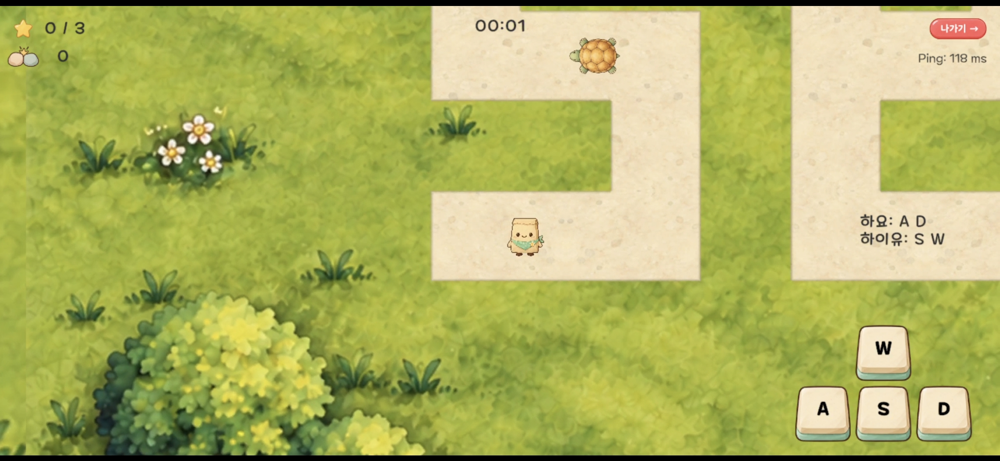

# 우왕좌왕 미로: 2인·4인 협동

**한 캐릭터를 여러 명이 조작할 때의 일관성**

무작위로 나눈 W·A·S·D 입력을 맞춰 별을 수집하고 목표 지점에 도달하는 온라인 협동 게임입니다.

[포트폴리오 PDF 보기](docs/portfolio.pdf) · [Google Play에서 보기](https://play.google.com/store/apps/details?id=com.parkwonkuk.kungjakjak) · [코드 읽는 순서](docs/code-guide.md) · [문제 해결 과정](docs/case-studies.md) · [아키텍처](docs/architecture.md)



## 프로젝트 개요

| 구분 | 내용 |
|---|---|
| 개발 기간 | 2025.12 - 2026.10 (10개월) |
| 개발 인원 | 1명 / 개인 프로젝트 |
| 담당 업무 | 게임 기획, 클라이언트·온라인 기능, UI 구현, 개인 기록 저장, Android 빌드·배포 |
| 출시 | Google Play 정식 출시 |
| 엔진·언어 | Unity 6 / 6000.3.6f1, C#, 비동기 처리(async/await) |
| 네트워크 | Netcode for GameObjects, UGS Lobby / Relay |
| 온라인 서비스 | UGS Authentication, Cloud Save, Leaderboards, Google Play Games |

2인 모드에서는 각자 두 방향, 4인 모드에서는 각자 한 방향을 나눠 맡습니다. 로컬 입력 반응과 호스트의 최종 판정을 분리하고, 확정 상태를 기준으로 클라이언트의 이동을 다시 계산했습니다.


## 핵심 구현 시스템

### 1. 호스트 권한형 공유 입력과 클라이언트 예측

- 참가자 ID·담당 키·명령 순서·Epoch를 검증해 잘못된 입력을 차단했습니다.
- 로컬 입력을 먼저 예측하고, 호스트 확정 상태에서 미처리 입력만 다시 적용했습니다.
- 호스트와 클라이언트가 같은 이동 규칙을 사용하도록 계산 로직을 분리했습니다.
- [상세 설계와 구현 과정](docs/troubleshooting/01_input_prediction.md) · [호스트 코드](src/Movement/HostMoveAuthority.cs) · [예측 코드](src/Movement/ClientMovePredictor.cs)

### 2. 인증·개인 기록·랭킹 제출의 단계별 실패 처리

- 인증 → 프로필 저장 → 개인 기록 저장 → 랭킹 제출 순서를 명시했습니다.
- 리더보드가 실패 Result를 반환해도 개인 기록 저장 결과는 유지했습니다.
- Google Play Games 연동·해제 시 중복 요청과 타 계정 연결 오류를 구분했습니다.
- [상세 처리 순서와 공개 범위](docs/troubleshooting/04_account_and_records.md) · [기록 저장 코드](src/Records/SubmitRunRecordUseCase.cs)

## 주요 트러블슈팅

### 1. 늦은 방향 입력을 보정하면서 확정 판정 보호

- 0.2초 이력 상한과 판정 경계 안에서 모든 참가자의 입력을 재계산했습니다.
- 과거의 새 수집·도착·위험 접촉이 생기면 상태를 복원하고 현재 틱 적용으로 전환했습니다.
- 별·골·위험 접촉과 배치 입력의 취소·복원을 4개 시나리오·45개 검사로 확인했습니다.
- [문제·선택 근거·복원 과정·관측 결과](docs/troubleshooting/02_limited_recalculation.md) · [재계산 코드](src/Movement/HostMoveAuthority.cs)

### 2. 이전 세션의 응답과 중복 종료 통지 처리

- 앱·세션·씬의 책임을 나누고 자원 정리와 로비 이동의 순서를 명시했습니다.
- 비동기 응답 후 요청 Scope와 현재 Scope를 비교해 이전 세션의 응답을 차단했습니다.
- 외부 .NET 검사에서 세션 교체·중복 종료 등 대표 사례의 조건과 결과를 확인했습니다.
- [종료 순서·이탈 정책·대표 검사 3개](docs/troubleshooting/03_session_lifecycle.md) · [세션 코드](src/Session/SessionLifetime.cs)

## 코드 읽는 순서

1. [SharedMovementRules.cs](src/Movement/SharedMovementRules.cs): 호스트와 클라이언트의 공통 이동 규칙
2. [ClientMovePredictor.cs](src/Movement/ClientMovePredictor.cs): 명령 보관, 확정 상태 반영과 미처리 입력 재적용
3. [HostMoveAuthority.cs](src/Movement/HostMoveAuthority.cs): 입력 검증, 틱별 이력 재생과 재계산 취소

나머지 세션·기록 코드를 포함한 10개 제품 코드 파일의 역할과 생략된 의존성은 [코드 가이드](docs/code-guide.md)에 정리했습니다.

## 저장소 구조

```text
src/
├── Movement/                   # 공통 이동 규칙, 예측·확정과 핵심 자료형
├── Session/                    # 세션 수명, 종료, 비동기 시작 요청
└── Records/                    # 개인 기록과 랭킹 제출 순서
docs/
├── troubleshooting/
│   ├── 01_input_prediction.md
│   ├── 02_limited_recalculation.md
│   ├── 03_session_lifecycle.md
│   └── 04_account_and_records.md
├── architecture.md             # 전체 책임·호출 흐름
├── code-guide.md               # 공개 코드 읽는 순서
└── case-studies.md             # 상세 사례 목차
tests/ReplayCancellationCase.cs  # 재계산 취소·복원 검사
assets/gameplay.png             # 실제 플레이 화면
README.md
```

## 공개 범위

출시 게임의 핵심 구현을 검토할 수 있도록 개발 프로젝트에서 제품 C# 파일 10개와 취소 분기 검사 코드 1개를 선별했습니다. 일부 자료형·인터페이스, Unity 연결 코드와 계정 연동 어댑터, 서비스 설정은 생략했습니다. 독립 실행용 프로젝트는 포함하지 않습니다.

외부 .NET 로직 검사, 단일 호스트 로그 관측, Unity Play Mode·UGS 실통신·다중 기기 검증은 구분하며, 상세 문서에 각각의 조건과 확인 범위를 명시했습니다.
