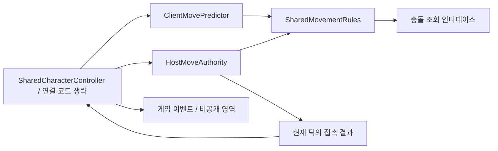

# 책임과 전체 호출 흐름

[게임 소개](../README.md) · [코드 가이드](code-guide.md) · [상세 사례 목차](case-studies.md)

## 공유 이동

호출자는 입력·RPC·틱 진행을 연결하며, 예측기와 호스트 권한 객체는 공통 이동 규칙을 사용합니다. 호스트가 반환한 현재 틱의 접촉 결과는 호출자가 게임 이벤트로 전달합니다.

- [입력 검증, 상태 식별값과 예측 처리 순서](troubleshooting/01_input_prediction.md)
- [제한적 재계산, 상태 복원과 이벤트 경계](troubleshooting/02_limited_recalculation.md)

## 수명별 책임

| 수명 | 책임 |
|---|---|
| 앱 | 프로필·공용 Store, 세션 수명 관리자 |
| 세션 | 방·Relay·네트워크·네트워크 씬 로더 |
| 씬 | 화면별 ViewModel, UI·입력 구독 |

종료 정책과 어댑터 자원 정리의 책임을 나눴습니다. 비동기 응답은 요청 당시 Scope와 현재 Scope를 비교해 적용 여부를 판단합니다.

- [종료 순서, 이탈 정책과 검사 사례](troubleshooting/03_session_lifecycle.md)
- [인증·개인 기록·랭킹 제출의 실패 경계](troubleshooting/04_account_and_records.md)
